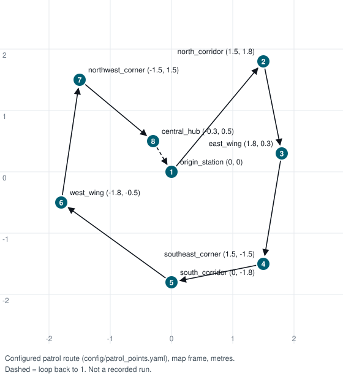

# ROS 2 Patrol Navigation (C++)

A TurtleBot3 patrols 8 waypoints in the Gazebo TurtleBot3 world with Nav2, in a loop; waypoints come from `config/patrol_points.yaml` and RViz markers show the waypoints, the path and the current target. ROS 2 Humble, C++17. The Python version is [ros2-patrol-project](https://github.com/AungKaung1928/ros2-patrol-project).

> **Simulator note (2026-09-05):** this project targets **Gazebo Classic 11** (`turtlebot3_gazebo`), which reached end-of-life in January 2025, and it is kept as-is rather than ported. For the same TurtleBot3 setup on **Gazebo Harmonic** (`ros_gz`), see [turtlebot3-wall-follower](https://github.com/AungKaung1928/turtlebot3-wall-follower).

## Quick start

Requires Ubuntu 22.04, ROS 2 Humble with Nav2 and the TurtleBot3 packages, and Gazebo Classic 11 (`sudo apt install ros-humble-navigation2 ros-humble-nav2-bringup 'ros-humble-turtlebot3*'`).

```bash
mkdir -p ~/patrol_navigation_cpp_ws/src
git clone <this repo URL> ~/patrol_navigation_cpp_ws/src/patrol_navigation_project_cpp
cd ~/patrol_navigation_cpp_ws
rosdep install --from-paths src --ignore-src -r -y     # first time only
colcon build --packages-select patrol_navigation_project_cpp
```

Terminal 1, the simulator:

```bash
export TURTLEBOT3_MODEL=burger
ros2 launch turtlebot3_gazebo turtlebot3_world.launch.py
```

Terminal 2, about 30 s later (Nav2 + patrol; the robot drives the waypoints in order and loops):

```bash
cd ~/patrol_navigation_cpp_ws && source install/setup.bash
export TURTLEBOT3_MODEL=burger
ros2 launch patrol_navigation_project_cpp patrol_navigation.launch.py
```



The route as configured in `config/patrol_points.yaml` (drawn by `scripts/plot_route.py`; CI fails if the figure and the config disagree). Not a recorded run.

## How it works

- `src/patrol_controller.cpp` sends each waypoint as a Nav2 `NavigateToPose` goal; on success it moves to the next index (modulo 8, so it loops).
- `src/waypoint_manager.cpp` loads the YAML; `src/patrol_visualizer.cpp` publishes the RViz markers.
- Nav2 settings are in `config/nav2_params.yaml`.

An aborted goal is retried on the same waypoint up to `max_retries` (3 in `config/patrol_points.yaml`), then the waypoint is skipped, as in the Python version; `retry_on_failure: false` stops the patrol instead. Limits: not measured: loop time, success rate, waypoint accuracy.

Test without Gazebo or Nav2: `cd src/patrol_navigation_project_cpp && launch_test test/test_launch_retry.py` (after `source install/setup.bash`) runs the installed node against a stand-in `navigate_to_pose` server that aborts every goal for the first point, and checks it is tried 4 times and then skipped. CI runs it in `ros:humble` on every push.

More: architecture, coverage map, layout, configuration, monitoring and troubleshooting in [docs/USAGE.md](docs/USAGE.md).

## License

Apache-2.0, see LICENSE.
